# Лекция 14. Навигация в React Native

В предыдущих лекциях мы писали экраны, которые занимали весь экран приложения: один компонент — один экран. Так можно сделать стартовый экран или экран профиля, но настоящее приложение почти всегда состоит из нескольких экранов, между которыми пользователь переходит.

Сегодня мы разбираем **навигацию** — механизм, который позволяет открывать один экран поверх другого, передавать между ними данные и возвращаться обратно.

Всё, что мы делаем, мы делаем на записанном приложении **Cupcake** — заказ торта. Приложение состоит из четырёх экранов:

```
Start ──► Начинка ──► Дата ──► Итог
```

Начинка выбирается на втором экране, дата — на третьем, на четвёртом мы видим собранный заказ. Обратите внимание: третий экран знает о выборе со второго, а четвёртый — обоих предыдущих. Это и есть задача навигации: не потерять данные при переходе между экранами.

> **Важно.** На лекции мы не «скачиваем готовый пример и запускаем». Мы пишем навигацию с нуля, прямо во время занятия. Файл `App.tsx` будет расти шаг за шагом, и после каждого шага вы будете видеть результат на эмуляторе или на телефоне.

---

## Где мы находимся: МДК 01.03 в системе междисциплинарных курсов

> **Материал для преподавателя.** Этот блок не читается студентам вслух целиком — это рамка занятия. На лекции по нему достаточно пройти за 2–3 минуты в начале.

### Что такое МДК

**МДК — междисциплинарный курс.** Это учебная единица программы среднего профессионального образования, которая в отличие от обычной дисциплины не замыкается на одном предмете. МДК собирает то, что в реальной разработке не бывает разнесено по разным кафедрам: язык программирования, архитектуру, хранение данных, работу с сетью и проверку качества. Студент осваивает их вместе и сразу на одном сквозном проекте, а не по отдельности.

Цифра в названии — номер МДК внутри профессионального модуля ПМ.01. Все МДК этого модуля описывают разные стороны одной работы программиста, и между ними есть прямые пересечения.

### Семейство МДК

| МДК                      | Название                                    | Что даёт студенту                                                          |
| ------------------------ | ------------------------------------------- | ------------------------------------------------------------------------- |
| **МДК 01.01**            | Разработка программных модулей             | Модуль как единица разработки: интерфейсы, зависимости, архитектура       |
| **МДК 01.02**            | Поддержка и тестирование программных модулей | Проверка качества: тест-дизайн, юнит-тесты, автотесты UI и API, CI/CD   |
| **МДК 01.03**            | **Разработка мобильных приложений**         | Клиентская разработка: TypeScript, React Native, навигация, состояние, API |
| **МДК 01.04**            | Системное программирование                 | Ядро платформы .NET: C#, ООП, асинхронность, файлы, БД, ASP.NET Core      |

Эта лекция — часть **МДК 01.03**, раздела «Навигация».

### Почему навигация — удобная точка для межпредметной связи

Навигация почти не имеет «собственных» знаний. `navigate`, `route.params`, стек экранов — это не про мобильные платформы, а про то, как устроен любой интерфейс с несколькими экранами. Поэтому лекция по навигации опирается сразу на несколько ранее пройденных тем. Это не повторение ради повторения: без каждой из них код навигатора просто не напишется.

| Что используем в этой лекции        | Откуда пришло                                                        | Зачем здесь                                                       |
| ----------------------------------- | ------------------------------------------------------------------- | ----------------------------------------------------------------- |
| Типы, объект-параметр, `useState`  | МДК 01.03, разд. 1 «Основы TypeScript» и разд. 3 «Состояние»       | Типизируем `route.params`, чтобы экран знал форму входных данных  |
| Компонент и его `props`             | МДК 01.03, разд. 2 «Основы React Native»                             | Экран — это компонент; навигатор передаёт ему `route` и `navigation` |
| Асинхронность, `Promise`, `try`     | МДК 01.03, разд. 4 (Практическая 13) и разд. 7 «Сетевые запросы»    | Экран итога получает данные асинхронно, показывает состояние загрузки |
| Хранение состояния между экранами   | МДК 01.03, разд. 8 «Хранение данных»                                  | Не теряем выбор при переходе и возврате назад                       |
| Стек как структура данных           | МДК 01.04, разд. 3 «Многопоточность и асинхронность»                 | `Stack.Navigator` — это буквально стек: последний вошёл — первый вышел |
| Инкапсуляция и передача данных     | МДК 01.04, разд. 2 «ООП»                                              | Экран прячет своё состояние, наружу отдаёт только `route` и `navigation` |
| Разделение на модули и контракты    | МДК 01.01, разработка программных модулей                             | `route.params` — это контракт между вызывающим и принимающим экраном |
| Тестируемость сценария              | МДК 01.02, разд. 4 «xUnit» и разд. 6 «Selenium WebDriver»              | Сквозной сценарий «выбрал → увидел» проверяется как готовый тест  |

Обратите внимание на последнюю строку. Сквозной сценарий, который мы собираем в конце лекции — выбрать начинку, выбрать дату, увидеть собранный заказ — это ровно тот тест-кейс, который в МДК 01.02 студенты оформляют как автотест. Одна и та же мысль, две разные формы подачи.

### Как это выглядит на занятии

Межпредметная связь в этой лекции **систематическая**, а не случайная, и проверяется это просто: если убрать любой из пунктов левого столбца, конкретный шаг лекции перестанет работать.

- Без **состояния** (разд. 3) нельзя запомнить выбранную начинку — и экран «Дата» не узнает, что выбрано.
- Без **типов** (разд. 1) параметры передаются как `any`, и опечатку в имени поля найдём только на телефоне.
- Без **асинхронности** (разд. 4, 7) итоговый экран не сможет дождаться данных.
- Без представления о **стеке** (МДК 01.04) не объяснить, почему `goBack` убирает последний экран, а `popToTop` — все сразу.

Именно поэтому порядок шагов в лекции фиксирован: каждый следующий шаг опирается на результат предыдущего, а не на новую тему.

### Пререквизиты

- Умение создавать проект Expo и запускать его в эмуляторе или на телефоне через Expo Go (раздел «Основы React Native»).
- Умение писать компоненты и использовать состояние `useState` (раздел «Состояние»).
- Базовое представление о props и о передаче данных внутрь компонента.

Полный список пререквизитов с указанием, из какого МДК и раздела пришла каждая тема, — в блоке «Где мы находимся» выше.

### Что вы узнаете

- Как установить и настроить библиотеку **React Navigation**.
- Как описать экраны приложения с помощью `NavigationContainer` и `Stack.Navigator`.
- Как переходить между экранами: `navigate`, `goBack`, `popToTop`, `reset`.
- Как передавать данные между экранами через `route.params`.
- Как настраивать заголовок экрана и убирать системную кнопку «Назад».

### Что вы создадите

Приложение **Cupcake** с четырьмя экранами:

| Экран        | Имя в навигаторе | Что делает                                  |
| ------------ | ---------------- | ------------------------------------------- |
| Старт        | `Start`          | Логотип, описание и кнопка «Заказать торт» |
| Начинка      | `Flavor`         | Выбор одного из четырёх вкусов              |
| Дата         | `Pickup`         | Выбор даты: сегодня, завтра, послезавтра    |
| Итог         | `Summary`        | Карточка заказа и кнопка «Новый заказ»     |

Все экраны вы увидите на эмуляторе Android или на настоящем телефоне.

### Как проходит занятие

Лекция рассчитана на **1 час 30 минут** и построена как живая демонстрация. Тайминг:

| Время        | Этап                                                | Результат                                   |
| ------------ | --------------------------------------------------- | ------------------------------------------- |
| 00:00–00:03  | Место лекции в МДК 01.03, обзор межпредметных связей | Студент видит, на что опирается занятие    |
| 00:03–00:08  | Вступление, создание проекта                        | Чистый проект Expo открывается на устройстве |
| 00:08–00:18  | Запуск Metro, запуск в эмуляторе или на телефоне     | Приложение запущено через Expo Go           |
| 00:18–00:32  | Установка React Navigation                          | Четыре пакета в `package.json`              |
| 00:32–00:50  | Создание четырёх экранов                            | Экраны есть, но перехода между ними нет     |
| 00:50–01:08  | `NavigationContainer`, `Stack.Navigator`, первый переход | Работающий переход Start → Начинка     |
| 01:08–01:24  | Передача параметров через `route.params`           | Заказ доходит до итогового экрана           |
| 01:24–01:30  | `goBack`, `popToTop`, итоги, домашнее задание       | Понимание, как вернуться назад              |

---

## Шаг 0. Создаём проект (00:00 — 00:08)

Откройте терминал в VS Code и создайте проект:

```bash
npx create-expo-app@latest cupcake --template blank-typescript
cd cupcake
```

Шаблон `blank-typescript` даёт минимальный проект на TypeScript — ровно то, с чего мы начнём. Через минуту-полторы в папке `cupcake` появятся `package.json`, `app.json` и файл `App.tsx`.

Откройте `App.tsx` и убедитесь, что там пока стандартный заготовочный экран:

```tsx
import { StatusBar } from 'expo-status-bar';
import { StyleSheet, Text, View } from 'react-native';

export default function App() {
  return (
    <View style={styles.container}>
      <Text>Open up App.tsx to start working on your app!</Text>
      <StatusBar style="auto" />
    </View>
  );
}

const styles = StyleSheet.create({
  container: {
    flex: 1,
    backgroundColor: '#fff',
    alignItems: 'center',
    justifyContent: 'center',
  },
});
```

**План на лекцию:** весь код мы напишем в одном файле `App.tsx`. Это сделано намеренно. Когда навигация будет понята, вы спокойно разнесёте экраны по отдельным файлам в `screens/`. Сначала — логика, потом структура проекта.

---

## Шаг 1. Запускаем Metro и открываем проект (00:08 — 00:18)

Запустите сборщик:

```bash
npx expo start
```

В терминале появится QR-код и адрес проекта:

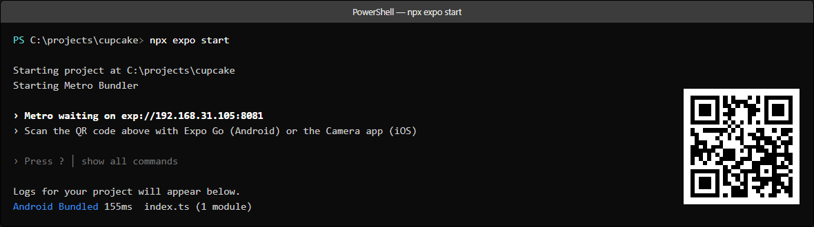

Дальше приложение нужно где-то открыть. Способов два, и выбирайте любой — код при этом одинаковый.

| | Эмулятор Android | Настоящий телефон |
|---|---|---|
| Что нужно | Android Studio или Android SDK | Телефон с Android и Expo Go |
| Как запустить | Клавиша `a` в терминале | Отсканировать QR-код |
| Сеть | Не нужна, всё локально | Нужна общая с компьютером Wi-Fi |
| Горячая перезагрузка | Работает | Работает |
| Подходит для | Демонстрации на занятии | Практики дома |

### Способ 1. Эмулятор Android (для показа на лекции)

Эмулятор — это виртуальный Android, запущенный прямо на компьютере. Для демонстрации он удобнее телефона: не нужно ничего подключать, ничего настраивать и ничего заряжать. Всё, что лектор делает в VS Code, сразу видно на большом экране проектора.

**Что должно быть установлено на компьютере**

1. **Включена аппаратная виртуализация.** Это самая частая причина, по которой эмулятор не запускается. Зайдите в **BIOS/UEFI** компьютера и найдите пункт `Intel Virtualization Technology` (VT-x) или `SVM Mode` (для процессоров AMD). Включите его и перезагрузите компьютер. В Windows 10/11 проверка включается в **Диспетчер задач → Производительность → ЦП → Виртуализация: включено**.
2. **Установлен Android Studio** (скачивается с <https://developer.android.com/studio>). Вместе с ним ставится Android SDK.
3. **Создан виртуальный телефон (AVD)** — один раз: в Android Studio откройте **Device Manager** (значок телефона на боковой панели) → **Create Virtual Device** → выберите профиль **Pixel 6** → в списке образов возьмите **API 34** с подписью **Google Play** (важно: нужен именно образ с Google Play, иначе Expo Go не установится из маркета) → нажмите **Finish**. Образ скачается автоматически, это 1–2 ГБ.

> **Важно про образы без Google Play.** Если выбрать обычный образ `AOSP` или `Google APIs` без Play Store, установить Expo Go из маркета не получится. Либо берите образ с Google Play, либо ставьте Expo Go вручную через `adb install`.

**Запуск проекта**

1. Запустите эмулятор: **Device Manager →** нажмите зелёную кнопку ▶ напротив вашего AVD. Дождитесь полной загрузки — на экране появится рабочий стол Android.
2. Запустите Metro: `npx expo start`.
3. Нажмите клавишу `a` в терминале.

Expo Go откроется на эмуляторе сам и подключится к проекту. Если он не установлен, Metro предложит скачать его — согласитесь.

Альтернатива клавише `a` — запустить эмулятор заранее отдельной командой и подключиться через adb:

```bash
npx expo start
# в другом терминале — убедиться, что эмулятор виден:
adb devices
```

Если эмулятор запущен, но Metro его не видит, выполните в терминале Metro команду `r` — перезагрузка приложения.

**Что означает адрес проекта**

На эмуляторе работает `exp://10.0.2.2:8081` или `exp://localhost:8081` — это специальные адреса, которыми эмулятор обозначает компьютер-хост. Они всегда одинаковые, менять их не нужно.

**Полезные клавиши в терминале Metro**

| Клавиша | Действие                        |
| :------: | ------------------------------- |
| `a`      | Открыть проект на Android       |
| `r`      | Перезагрузить приложение        |
| `d`      | Открыть меню разработчика       |
| `j`      | Открыть отладчик в браузере     |
| `q`      | Остановить Metro                |

### Способ 2. Настоящий телефон (для практики)

Телефон и компьютер должны быть в **одной сети Wi-Fi**. Компьютер смотрит в эмуляторе или камере, телефон — в другой сети (например, мобильный интернет), и связаться они не смогут.

**Настройка телефона для отладки по кабелю** (нужна один раз, если хотите подстраховаться кабелем вместо Wi-Fi):

1. **Настройки** → **О телефоне**.
2. Найдите строку **Номер сборки** и тапните по ней **7 раз подряд**. Появится сообщение «Вы стали разработчиком».
3. Вернитесь в **Настройки** → **Система** → **Для разработчиков**.
4. Включите **Отладка по USB**.
5. Подтвердите на телефоне «Разрешить отладку по USB», когда появится диалог.

**Что означает адрес проекта для телефона**

`exp://192.168.31.105:8081` — это сетевой адрес **вашего компьютера**, а не локальный `localhost`. Проверить, какой адрес у компьютера, можно так:

```bash
ipconfig
```

Найдите строку `IPv4-адрес` у вашего Wi-Fi-адаптера. Если компьютер подключён по проводу или к другой сети, адрес будет другим — важно, чтобы он был из той же подсети, что и телефон.

**Открываем проект**

1. Установите **Expo Go** из **Google Play** на телефон и запустите.
2. Наведите камеру телефона на QR-код в терминале — приложение откроется само. Либо в Expo Go выберите **Enter URL manually** и введите адрес из терминала.

### Проверяем, что всё работает

На экране эмулятора или телефона должен появиться заготовочный текст `Open up App.tsx...`. Если он есть — можно двигаться дальше. Вся остальная работа лекции будет выглядеть так: вы правите `App.tsx`, сохраняете файл, и через 1–2 секунды картинка на устройстве обновляется сама.

> **Подсказка.** Если экран не обновился, нажмите `r` в терминале или откройте меню разработчика: клавиша `d` в терминале Metro, а на телефоне — встряхнуть устройство. Иногда помогает перезапуск Metro.

> **Если эмулятор не запускается совсем.** Скопируйте сообщение об ошибке и проверьте три вещи: включена ли виртуализация в BIOS, скачан ли нужный системный образ, не занята ли память. Эмулятор требует примерно 4 ГБ оперативной памяти. Если компьютер слабый, для показа можно запустить приложение в браузере — клавиша `w` в терминале Metro. Код будет тот же самый, отличается только оболочка.

---

## Шаг 2. Устанавливаем React Navigation (00:18 — 00:32)

React Navigation — это стандартная библиотека навигации для React Native. Ставится одной командой:

```bash
npx expo install @react-navigation/native @react-navigation/native-stack react-native-screens react-native-safe-area-context
```

Команда выполняется 30–90 секунд. Нормальный вывод выглядит так:

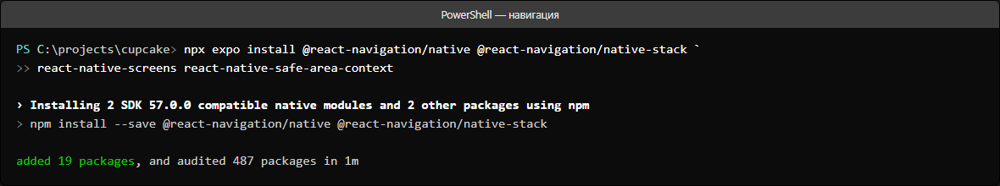

Обратите внимание на строчку `Installing 2 SDK 57.0.0 compatible native modules and 2 other packages`. Это не ошибка, а объяснение: из четырёх пакетов два содержат нативный код (`react-native-screens` и `react-native-safe-area-context`) и должны быть собраны под вашу версию SDK, а два остальных — обычный JavaScript.

> **Почему `npx expo install`, а не `npm install`?** Expo знает, какие версии пакетов совместимы с текущей версией SDK. Обычный `npm install` может поставить слишком новую или слишком старую версию, и приложение упадёт с непонятной ошибкой при запуске.

### Что установилось и зачем

| Пакет                            | Зачем                                                         |
| -------------------------------- | ------------------------------------------------------------- |
| `@react-navigation/native`       | Ядро: контейнер, переходы, работа с состоянием навигации      |
| `@react-navigation/native-stack`| Навигатор стека — экраны как стопка карточек                   |
| `react-native-screens`          | Нативная оптимизация: анимации переходов быстрее               |
| `react-native-safe-area-context` | Отступы от вырезов и чужеродков (чёлка, «островок» камеры)     |

Проверьте, что в `package.json` появились все четыре:

```json
{
  "dependencies": {
    "@react-navigation/native": "^7.5.1",
    "@react-navigation/native-stack": "^7.21.0",
    "expo": "~57.0.28",
    "react": "19.2.3",
    "react-native": "0.86.3",
    "react-native-safe-area-context": "~5.7.0",
    "react-native-screens": "~4.26.0"
  }
}
```

Если всё на месте — устройство можно не трогать, идём писать экраны.

---

## Шаг 3. Создаём четыре экрана (00:32 — 00:50)

Сначала сделаем экраны **без навигации**: это обычные компоненты, которые мы уже умеем писать. Переходы добавим на следующем шаге. Так проще заметить, что именно меняет навигация.

### Данные, которые нам понадобятся

Начинки и даты вынесем в массивы прямо в файле. В реальном проекте эти данные приходят с сервера, но для учебной задачи массивы — честный и понятный способ.

```tsx
const FLAVORS = [
  { name: 'Ваниль', emoji: '🍦' },
  { name: 'Шоколад', emoji: '🍫' },
  { name: 'Клубника', emoji: '🍓' },
  { name: 'Лимон', emoji: '🍋' },
];

const DATES = [
  { name: 'Сегодня', emoji: '📅' },
  { name: 'Завтра', emoji: '🗓️' },
  { name: 'Послезавтра', emoji: '📆' },
];
```

### Переиспользуемый компонент `Option`

Оба экрана выбора устроены одинаково: список карточек, у выбранной карточки другая рамка и заполненная точка. Чтобы не копировать разметку дважды, вынесем её в отдельный компонент.

```tsx
function Option({ emoji, title, selected, onPress }: any) {
  return (
    <Pressable
      onPress={onPress}
      style={[styles.option, selected && styles.optionSelected]}
    >
      <Text style={styles.optionEmoji}>{emoji}</Text>
      <Text style={styles.optionTitle}>{title}</Text>
      <View style={[styles.radio, selected && styles.radioSelected]}>
        {selected ? <View style={styles.radioDot} /> : null}
      </View>
    </Pressable>
  );
}
```

Разберём по частям:

- `Pressable` — элемент, который реагирует на нажатие. Это «кнопка» без готового оформления, полностью под наш контроль.
- `style={[styles.option, selected && styles.optionSelected]}` — массив стилей. Второй элемент равен `false`, если ничего не выбрано; React Native такие значения просто игнорирует. Читается как «базовый стиль **и**, если выбрано, ещё и подсветка».
- `{selected ? <View .../> : null}` — классический приём. Если `selected` равно `true`, рисуем точку; иначе `null` означает «не рисуй ничего».

> **Зачем вообще `Pressable`, а не `<View>`?** `View` не знает про касания. `Pressable` умеет вызывать `onPress` и при этом поддерживает стиль нажатия.

### 3.1 Стартовый экран

```tsx
function StartScreen() {
  return (
    <View style={styles.center}>
      <Text style={styles.bigEmoji}>🧁</Text>
      <Text style={styles.heading}>Cupcake</Text>
      <Text style={styles.subtitle}>
        Закажите торт и мы приготовим его{'\n'}к указанному времени
      </Text>
      <Pressable style={styles.button}>
        <Text style={styles.buttonText}>Заказать торт</Text>
      </Pressable>
    </View>
  );
}
```

Сейчас кнопка ничего не делает — это нормально, навигацию подключим позже. Посмотрим, как выглядит экран на устройстве:

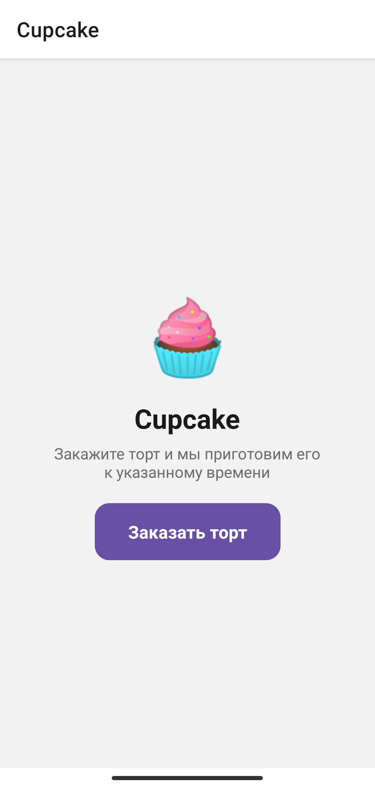

### 3.2 Экран выбора начинки

Состояние выбранной начинки живёт **внутри этого экрана** — экран не должен знать про другие экраны.

```tsx
function FlavorScreen() {
  const [flavor, setFlavor] = useState<string | null>(null);

  return (
    <View style={styles.container}>
      <Text style={styles.heading}>Выберите начинку</Text>
      <Text style={styles.subtitle}>Шаг 1 из 3</Text>

      <View style={styles.list}>
        {FLAVORS.map((item) => (
          <Option
            key={item.name}
            emoji={item.emoji}
            title={item.name}
            selected={flavor === item.name}
            onPress={() => setFlavor(item.name)}
          />
        ))}
      </View>

      <Pressable
        style={[styles.button, flavor === null && styles.buttonDisabled]}
        disabled={flavor === null}
      >
        <Text style={styles.buttonText}>Далее</Text>
      </Pressable>
    </View>
  );
}
```

Что здесь важно:

- `useState<string | null>(null)` — начальное значение `null`, то есть «ничего не выбрано». Тип `string | null` честно отражает оба состояния.
- `FLAVORS.map((item) => ...)` — превращаем массив данных в список компонентов.
- `key={item.name}` — обязательное свойство при отрисовке массивов. Без него React не сможет понять, какой элемент изменился.
- `selected={flavor === item.name}` — для каждой карточки отдельная проверка: выбрана ли именно она.
- `disabled={flavor === null}` — кнопка «Далее» неактивна, пока не выбран вкус.

Пока ничего не выбрано, кнопка серая:

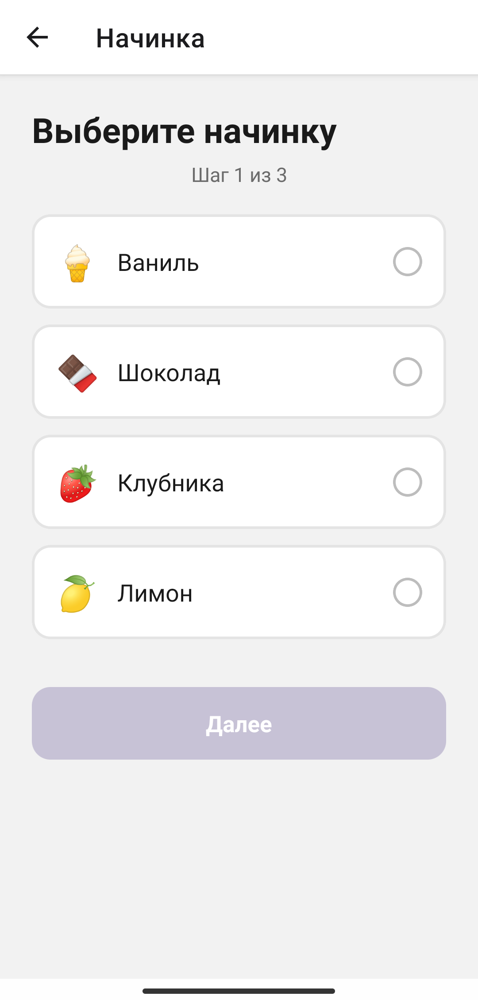

Тапаем «Шоколад» — карточка подсвечивается, кнопка становится фиолетовой:

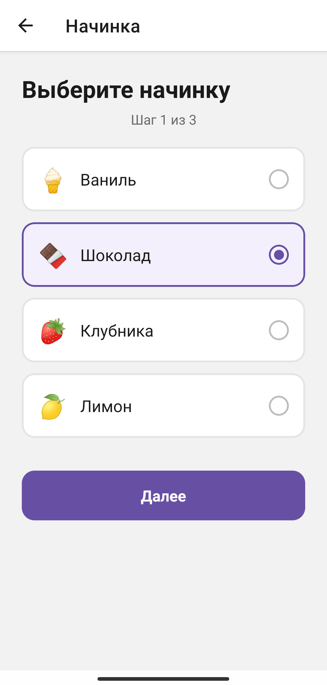

### 3.3 Экран выбора даты

Экран почти повторяет предыдущий, меняются только заголовок и данные. Именно поэтому мы и вынесли карточку в отдельный компонент `Option` — повторять разметку не нужно.

```tsx
function PickupScreen() {
  const [date, setDate] = useState<string | null>(null);

  return (
    <View style={styles.container}>
      <Text style={styles.heading}>Когда забрать?</Text>
      <Text style={styles.subtitle}>Шаг 2 из 3</Text>

      <View style={styles.list}>
        {DATES.map((item) => (
          <Option
            key={item.name}
            emoji={item.emoji}
            title={item.name}
            selected={date === item.name}
            onPress={() => setDate(item.name)}
          />
        ))}
      </View>

      <Pressable
        style={[styles.button, date === null && styles.buttonDisabled]}
        disabled={date === null}
      >
        <Text style={styles.buttonText}>Далее</Text>
      </Pressable>
    </View>
  );
}
```

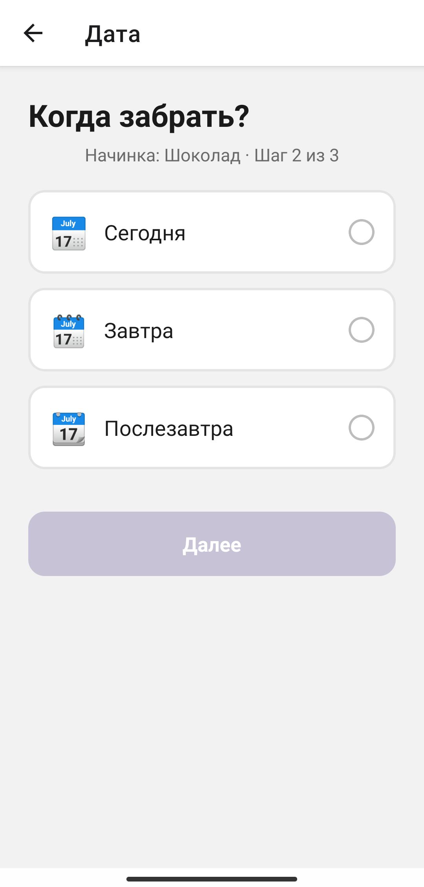

Выбираем «Завтра»:

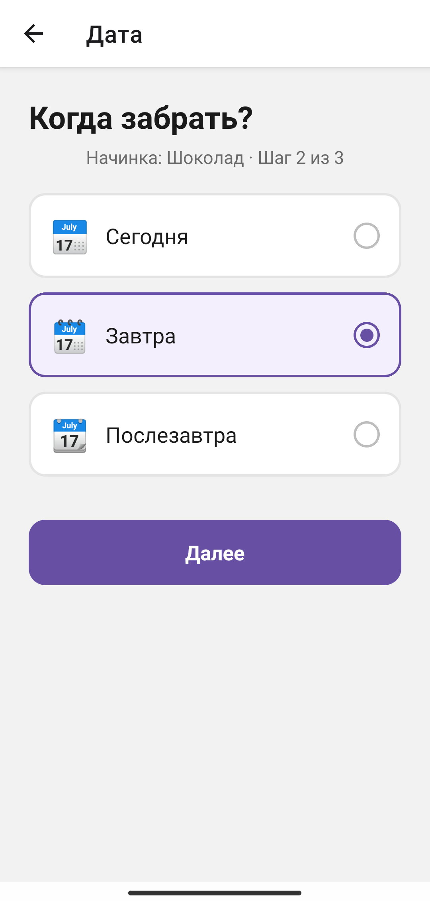

### 3.4 Экран итога

Здесь покажем обе части заказа. Значения `flavor` и `date` пока пропишем вручную — на следующем шаге заменим их на настоящие данные из навигации.

```tsx
function SummaryScreen() {
  return (
    <View style={styles.container}>
      <Text style={styles.heading}>Ваш заказ</Text>
      <Text style={styles.subtitle}>Проверьте всё верно</Text>

      <View style={styles.card}>
        <View style={styles.cardRow}>
          <Text style={styles.cardLabel}>Начинка</Text>
          <Text style={styles.cardValue}>Шоколад</Text>
        </View>
        <View style={styles.divider} />
        <View style={styles.cardRow}>
          <Text style={styles.cardLabel}>Забрать</Text>
          <Text style={styles.cardValue}>Завтра</Text>
        </View>
      </View>
    </View>
  );
}
```

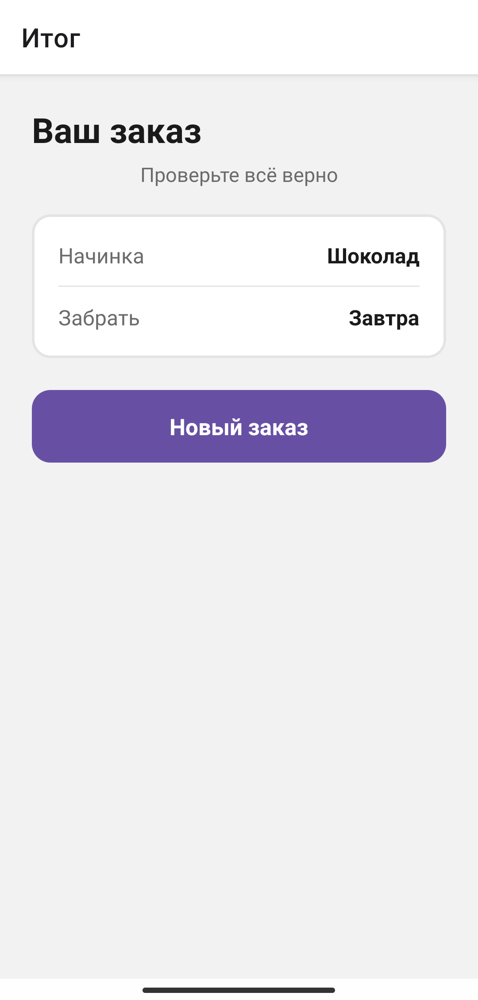

> **Явление.** Откройте все четыре экрана. Сейчас приложение показывает только `Start`, потому что в `App.tsx` мы пока возвращаем `<StartScreen />` напрямую. Никакого перехода между экранами нет — кнопка «Заказать торт» просто ничего не делает. Это ожидаемо: навигации в проекте ещё нет. Сейчас мы её добавим.

---

## Шаг 4. Собираем навигатор (00:50 — 01:08)

Теперь главное. Вверху файла добавьте импорты и создайте навигатор:

```tsx
import { NavigationContainer } from '@react-navigation/native';
import { createNativeStackNavigator } from '@react-navigation/native-stack';

const Stack = createNativeStackNavigator();
```

`createNativeStackNavigator()` вызывается **один раз**, на верхнем уровне файла — не внутри компонента. Это важно: навигатор хранит состояние стека, и если создавать его при каждом рендере, история экранов будет сбрасываться.

Теперь перепишите функцию `App`:

```tsx
export default function App() {
  return (
    <NavigationContainer>
      <Stack.Navigator initialRouteName="Start">
        <Stack.Screen
          name="Start"
          component={StartScreen}
          options={{ title: 'Cupcake' }}
        />
      </Stack.Navigator>
      <StatusBar style="auto" />
    </NavigationContainer>
  );
}
```

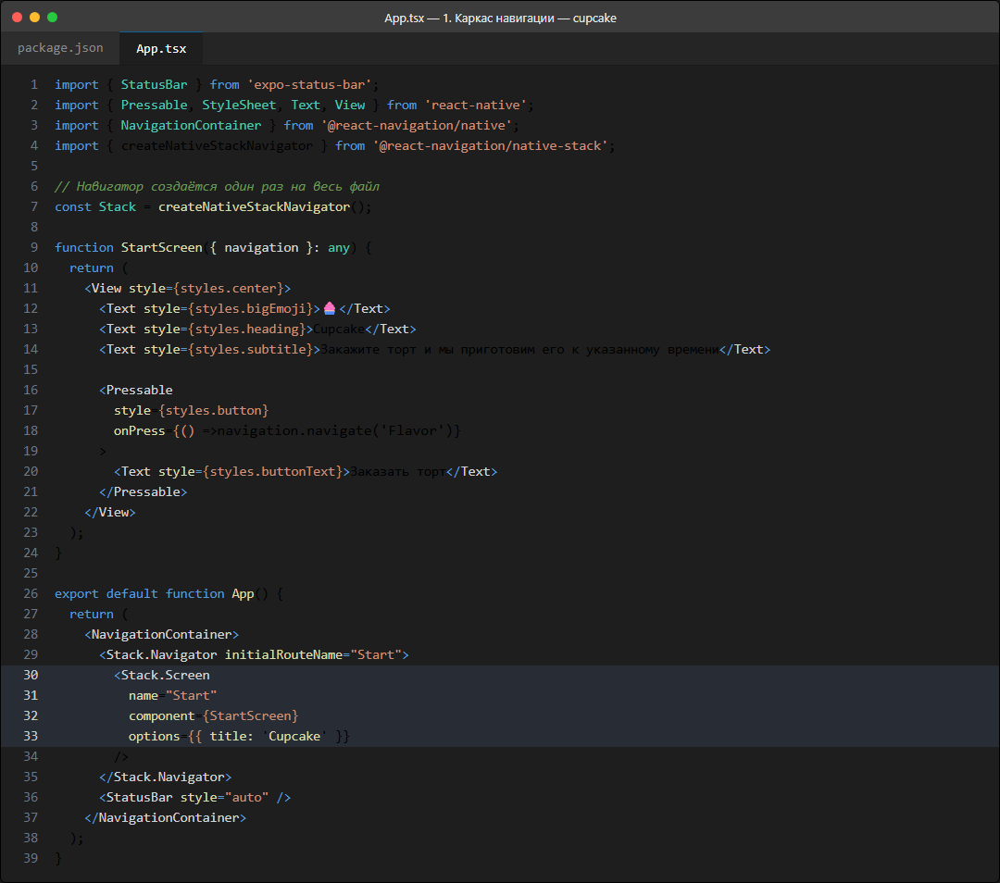

Разберём три элемента:

**`NavigationContainer`** — самый внешний. Это «движок», который хранит текущий экран и историю переходов. Без него `Stack.Navigator` работать не будет.

**`Stack.Navigator`** — сам стек. Он описывает, какие экраны вообще существуют и в каком порядке.

**`Stack.Screen`** — один экран стека:

| Свойство    | Значение        | Что делает                                              |
| ----------- | --------------- | ------------------------------------------------------- |
| `name`      | `'Start'`       | Имя экрана. Именно его мы будем писать в `navigate(...)` |
| `component` | `StartScreen`   | Компонент, который нужно отрисовать                     |
| `options`   | `{ title: ... }`| Заголовок экрана и другие настройки                     |

`initialRouteName="Start"` говорит: «при запуске покажи этот экран». Обратите внимание — имя указано строкой, а компонент передаётся отдельно. Так вы можете назвать экран как удобно для кода, а показывать пользователю другой заголовок.

Сохраните файл. Экран на устройстве не изменится — по-прежнему будет `Cupcake` с кнопкой. Но теперь он рисуется **системным заголовком** «Cupcake» сверху. Это работа `Stack.Navigator`.

### Делаем первый переход

Осталось сказать кнопке, куда переходить. Измените `StartScreen`:

```tsx
function StartScreen({ navigation }: any) {
  return (
    <View style={styles.center}>
      <Text style={styles.bigEmoji}>🧁</Text>
      <Text style={styles.heading}>Cupcake</Text>
      <Text style={styles.subtitle}>
        Закажите торт и мы приготовим его{'\n'}к указанному времени
      </Text>
      <Pressable
        style={styles.button}
        onPress={() => navigation.navigate('Flavor')}
      >
        <Text style={styles.buttonText}>Заказать торт</Text>
      </Pressable>
    </View>
  );
}
```

И добавьте второй экран в навигатор:

```tsx
<Stack.Screen
  name="Flavor"
  component={FlavorScreen}
  options={{ title: 'Начинка' }}
/>
```

Два изменения, и оба обязательные:

1. **Экран должен быть зарегистрирован** в `Stack.Navigator`, иначе `navigate('Flavor')` не найдёт его.
2. **В компонент экрана должен прийти `navigation`.** React Navigation передаёт его как обычный prop — специально импортировать ничего не нужно.

Теперь сохраните файл и нажмите «Заказать торт» на устройстве. Переход сработал: на экране появился заголовок «Начинка» и **кнопка «Назад»** в левом верхнем углу. Эта кнопка появилась сама — её не нужно рисовать в коде.

> **Как это работает внутри.** `Stack.Navigator` хранит массив: `['Start', 'Flavor']`. При `navigate('Flavor')` в конец добавляется новый экран, предыдущий остаётся под ним. Кнопка «Назад» убирает последний элемент и показывает тот, что под ним. Отсюда название «стек» — это поведение точь-в-точь как у стопки бумаг.

### Проверяем на устройстве

Прошли весь путь: `Start` → `Flavor`. Нажмите системную кнопку «Назад» или кнопку «Назад» в шапке — вы вернётесь на `Start`. Потом снова вперёд. Экран `Flavor` откроется заново, и выбранная начинка сбросится: это **новый** экран в стеке.

---

## Шаг 5. Передаём параметры между экранами (01:08 — 01:24)

Вернёмся к нашим экранам. Сейчас выбор начинки живёт в состоянии `FlavorScreen` и никуда не девается — но и на другие экраны не попадает. Данные нужно передать дальше.

### Второй аргумент `navigate`

У `navigate` есть необязательный второй аргумент — объект параметров:

```tsx
navigation.navigate('ИмяЭкрана', { поле1: значение1, поле2: значение2 });
```

На втором экране эти параметры лежат в `route.params`. Измените `FlavorScreen` — добавим `navigation` в аргументы и отдадим выбранный вкус дальше:

```tsx
function FlavorScreen({ navigation }: any) {
  const [flavor, setFlavor] = useState<string | null>(null);

  return (
    <View style={styles.container}>
      <Text style={styles.heading}>Выберите начинку</Text>
      <Text style={styles.subtitle}>Шаг 1 из 3</Text>

      <View style={styles.list}>
        {FLAVORS.map((item) => (
          <Option
            key={item.name}
            emoji={item.emoji}
            title={item.name}
            selected={flavor === item.name}
            onPress={() => setFlavor(item.name)}
          />
        ))}
      </View>

      <Pressable
        style={[styles.button, flavor === null && styles.buttonDisabled]}
        disabled={flavor === null}
        onPress={() => navigation.navigate('Pickup', { flavor })}
      >
        <Text style={styles.buttonText}>Далее</Text>
      </Pressable>
    </View>
  );
}
```

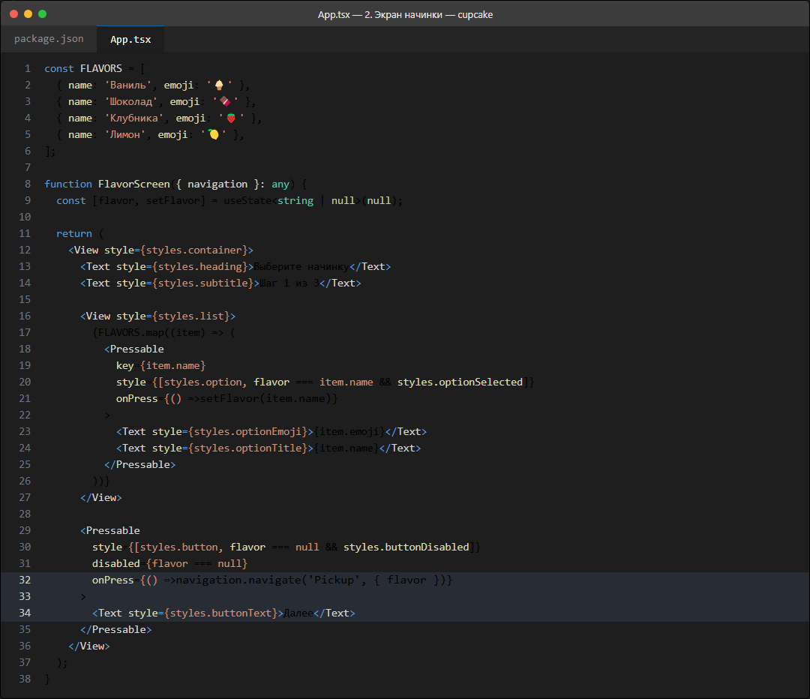

Ключевая строка — `navigate('Pickup', { flavor })`. Всё, что было в фигурных скобках, станет доступно на следующем экране.

> **Почему `{ flavor }`, а не `{ flavor: flavor }`?** Это сокращённая запись. Ключ и имя переменной совпадают, поэтому можно писать `{ flavor }`. Если бы поле называлось иначе, пришлось бы писать `{ selectedFlavor: flavor }`.

### Читаем параметры на следующем экране

Экрану нужны **два** пропса: `navigation`, чтобы перейти дальше, и `route`, чтобы прочитать то, что передали. Измените `PickupScreen`:

```tsx
function PickupScreen({ navigation, route }: any) {
  const { flavor } = route.params;
  const [date, setDate] = useState<string | null>(null);

  return (
    <View style={styles.container}>
      <Text style={styles.heading}>Когда забрать?</Text>
      <Text style={styles.subtitle}>
        Начинка: {flavor} · Шаг 2 из 3
      </Text>

      <View style={styles.list}>
        {DATES.map((item) => (
          <Option
            key={item.name}
            emoji={item.emoji}
            title={item.name}
            selected={date === item.name}
            onPress={() => setDate(item.name)}
          />
        ))}
      </View>

      <Pressable
        style={[styles.button, date === null && styles.buttonDisabled]}
        disabled={date === null}
        onPress={() => navigation.navigate('Summary', { flavor, date })}
      >
        <Text style={styles.buttonText}>Далее</Text>
      </Pressable>
    </View>
  );
}
```

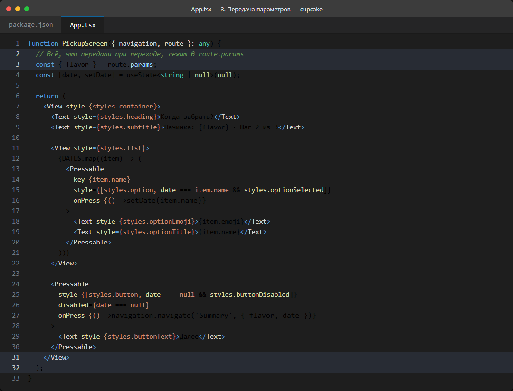

Три момента, на которые стоит обратить внимание:

- **Деструктуризация.** `const { flavor } = route.params` — короткая запись для `const flavor = route.params.flavor`.
- **Параметры приходят в том же пропсе.** `route` — это «запись» о том, как мы попали на экран: имя, параметры, ключ. `navigation` — это «пульт» управления: куда перейти.
- **Накопление данных.** В `navigate('Summary', { flavor, date })` мы передаём **не только** дату, но и начинку, полученную выше. Экран не умеет спросить у предыдущего, что тот выбрал, — поэтому передаём всё явно.

### Собираем заказ на итоговом экране

Финальный экран получает оба значения:

```tsx
function SummaryScreen({ route, navigation }: any) {
  const { flavor, date } = route.params;

  return (
    <View style={styles.container}>
      <Text style={styles.heading}>Ваш заказ</Text>
      <Text style={styles.subtitle}>Проверьте всё верно</Text>

      <View style={styles.card}>
        <View style={styles.cardRow}>
          <Text style={styles.cardLabel}>Начинка</Text>
          <Text style={styles.cardValue}>{flavor}</Text>
        </View>
        <View style={styles.divider} />
        <View style={styles.cardRow}>
          <Text style={styles.cardLabel}>Забрать</Text>
          <Text style={styles.cardValue}>{date}</Text>
        </View>
      </View>

      <Pressable
        style={styles.button}
        onPress={() => navigation.popToTop()}
      >
        <Text style={styles.buttonText}>Новый заказ</Text>
      </Pressable>
    </View>
  );
}
```

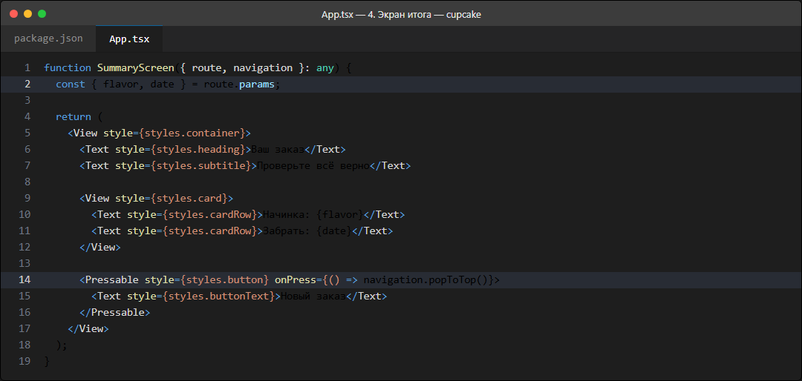

Не забудьте заменить «Шоколад» и «Завтра» на `{flavor}` и `{date}`, а кнопку добавить в навигатор:

```tsx
<Stack.Screen
  name="Pickup"
  component={PickupScreen}
  options={{ title: 'Дата' }}
/>
<Stack.Screen
  name="Summary"
  component={SummaryScreen}
  options={{ title: 'Итог', headerBackVisible: false }}
/>
```

### Проверяем сквозной сценарий

Прошли весь заказ: выбрали **Шоколад** → выбрали **Завтра** → увидели карточку с обеими позициями. Обратите внимание: мы нигде не хранили заказ глобально. Данные пронеслись через параметры перехода.

> **Осторожно: параметры копируются.** `route.params` — это снимок на момент перехода. Если пользователь вернётся назад на экран начинки и выберет другой вкус, старый экран даты останется с прежним значением. Это частая причина «залипания» данных. Лечится либо `reset`, либо правильной архитектурой состояния — об этом будем говорить в разделе «Управление состоянием».

---

## Шаг 6. Возврат назад: `goBack` и `popToTop` (01:24 — 01:30)

### Системная кнопка «Назад» и `goBack`

На всех экранах, кроме первого, React Navigation показывает кнопку «Назад» в шапке. Она вызывает `goBack()` — убирает верхний экран из стека.

Программно то же самое делает:

```tsx
navigation.goBack();
```

Например, добавьте на экран итога вторую кнопку «Изменить», которая возвращает на выбор даты:

```tsx
<Pressable
  style={[styles.button, styles.buttonSecondary]}
  onPress={() => navigation.goBack()}
>
  <Text style={styles.buttonText}>Изменить дату</Text>
</Pressable>
```

> **`goBack()` на первом экране** ничего не делает и печатает предупреждение в консоль: стек пуст, идти больше некуда. Если ваша кнопка может оказаться на `Start`, проверяйте `navigation.canGoBack()` заранее.

### Прячем кнопку «Назад» на итоговом экране

Кнопка «Новый заказ» возвращает пользователя в самое начало, минуя два промежуточных экрана. Логично: если он начал новый заказ, возвращаться назад по старому не нужно. Поэтому на `Summary` мы убираем шапку целиком:

```tsx
<Stack.Screen
  name="Summary"
  component={SummaryScreen}
  options={{ title: 'Итог', headerBackVisible: false }}
/>
```

`headerBackVisible: false` убирает только стрелку. Если убрать и заголовок, добавьте `headerShown: false`.

### `popToTop` — вернуться в начало сразу

```tsx
navigation.popToTop();
```

Этот вызов убирает из стека **все** экраны, кроме самого первого. В нашем случае стек выглядит так:

```
['Start', 'Flavor', 'Pickup', 'Summary']
```

После `popToTop()` останется:

```
['Start']
```

Пользователь сразу оказывается на стартовом экране с чистой формой — можно оформлять новый заказ. Именно это и делает кнопка «Новый заказ».

### Полная карта экранов

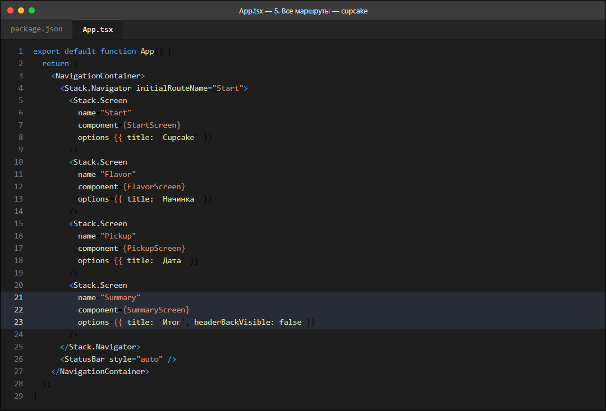

Финальный `App` целиком:

```tsx
export default function App() {
  return (
    <NavigationContainer>
      <Stack.Navigator initialRouteName="Start">
        <Stack.Screen
          name="Start"
          component={StartScreen}
          options={{ title: 'Cupcake' }}
        />
        <Stack.Screen
          name="Flavor"
          component={FlavorScreen}
          options={{ title: 'Начинка' }}
        />
        <Stack.Screen
          name="Pickup"
          component={PickupScreen}
          options={{ title: 'Дата' }}
        />
        <Stack.Screen
          name="Summary"
          component={SummaryScreen}
          options={{ title: 'Итог', headerBackVisible: false }}
        />
      </Stack.Navigator>
      <StatusBar style="auto" />
    </NavigationContainer>
  );
}
```

### Шпаргалка по методам навигации

| Вызов                       | Что делает                                                     |
| --------------------------- | -------------------------------------------------------------- |
| `navigate('Flavor')`        | Открывает экран `Flavor`, кладёт его поверх текущего            |
| `navigate('Pickup', {...})` | То же, но передаёт параметры                                    |
| `navigate('Start')`         | Если `Start` уже есть в стеке — возвращается к нему, а не дублирует |
| `goBack()`                  | Убирает текущий экран, показывает предыдущий                    |
| `popToTop()`                | Убирает все экраны до первого                                   |
| `reset(...)`                | Полностью пересобирает стек по новому описанию                  |
| `canGoBack()`               | `true`, если есть куда возвращаться                             |

Пример полного сброса с параметрами:

```tsx
navigation.reset({
  index: 0,
  routes: [{ name: 'Home' }],
});
```

---

## Что чаще всего ломается

### `navigation.navigate` не работает

Проверьте три вещи по порядку:

1. **Экран зарегистрирован?** Имя в `navigate('Flavor')` должно точно совпадать с `name="Flavor"` в `Stack.Navigator`. Регистр важен: `flavor` и `Flavor` — разные имена.
2. **Компонент получает `navigation`?** Если забыть `{ navigation }` в аргументах функции, объект будет `undefined` и при нажатии вы увидите ошибку.
3. **`NavigationContainer` на месте?** Он должен быть самым внешним элементом.

### `route.params` — `undefined`

Экран попал сюда не через `navigate` с параметрами. Либо забыли второй аргумент, либо экран открылся как `initialRouteName`. Защититься можно так:

```tsx
const { flavor } = route.params ?? {};
```

### Не установлен `react-native-screens`

Ошибка вида `Native module: 'RNSScreen' not found` или `Failed to create a new native view` означает, что пакеты нативных модулей не установлены или требуют пересборки. Выполните:

```bash
npx expo install react-native-screens react-native-safe-area-context
npx expo start --clear
```

И перезапустите приложение в Expo Go — иногда помогает только полная перезагрузка.

### Навигатор создаётся внутри компонента

```tsx
// Неправильно
function App() {
  const Stack = createNativeStackNavigator();
  // ...
}
```

Каждый рендер создаёт новый навигатор, и история переходов сбрасывается. `createNativeStackNavigator()` должен вызываться **один раз**, вне компонента.

### Кнопка «Назад» есть на первом экране

Значит, `initialRouteName` не совпадает с тем экраном, который вы считаете первым. Посмотрите в консоли на первый вызов `navigate` — Metro печатает туда текущий маршрут.

---

## Итог

- **Навигация в React Native** — это компонент-дерево, а не набор `if`-ов. Вы описываете экраны один раз, а переключаете их вызовом `navigate`.
- **`NavigationContainer`** — корень всей навигации, он хранит текущий экран и историю.
- **`Stack.Navigator` и `Stack.Screen`** — описание экранов: имя, компонент, настройки заголовка.
- **`navigation.navigate('Имя', { ... })`** переходит на экран и передаёт данные. **`route.params`** читает их на месте.
- **Параметры копируются**, а не разделяются. Меняете значение на одном экране — на следующем останется старое.
- **`goBack()`** возвращает на один экран назад, **`popToTop()`** — сразу в начало.
- **`options`** настраивает заголовок: `title`, `headerBackVisible`, `headerShown`.

---

## Домашнее задание

1. **Добавьте пятый экран.** Между «Дата» и «Итог» вставьте экран `Address` — ввод адреса доставки. Сделайте его обязательным: кнопка «Далее» на экране даты неактивна, пока адрес не введён. Проверьте, что адрес доезжает до итоговой карточки.
2. **Разберитесь с `reset`.** Замените `popToTop()` на экране итога на `navigation.reset({ index: 0, routes: [{ name: 'Start' }] })`. Сравните поведение: что изменилось в стеке?
3. **Настройте заголовки.** Для `Pickup` задайте `options={{ title: 'Когда забрать', headerStyle: { backgroundColor: '#F3EFFC' } }}`. Что изменилось в шапке?
4. **Защитите `route.params`.** Попробуйте открыть экран `Summary` кнопкой прямо со стартового экрана (`navigation.navigate('Summary')`). Убедитесь, что приложение не падает — используйте `route.params ?? {}` и значения по умолчанию.

---

## Приложение. Полный код App.tsx

Итоговый файл после лекции. Сохраните его себе как эталон.

```tsx
import { StatusBar } from 'expo-status-bar';
import { useState } from 'react';
import { Pressable, StyleSheet, Text, View } from 'react-native';
import { NavigationContainer } from '@react-navigation/native';
import { createNativeStackNavigator } from '@react-navigation/native-stack';

const Stack = createNativeStackNavigator();

const FLAVORS = [
  { name: 'Ваниль', emoji: '🍦' },
  { name: 'Шоколад', emoji: '🍫' },
  { name: 'Клубника', emoji: '🍓' },
  { name: 'Лимон', emoji: '🍋' },
];

const DATES = [
  { name: 'Сегодня', emoji: '📅' },
  { name: 'Завтра', emoji: '🗓️' },
  { name: 'Послезавтра', emoji: '📆' },
];

function Option({ emoji, title, selected, onPress }: any) {
  return (
    <Pressable
      onPress={onPress}
      style={[styles.option, selected && styles.optionSelected]}
    >
      <Text style={styles.optionEmoji}>{emoji}</Text>
      <Text style={styles.optionTitle}>{title}</Text>
      <View style={[styles.radio, selected && styles.radioSelected]}>
        {selected ? <View style={styles.radioDot} /> : null}
      </View>
    </Pressable>
  );
}

function StartScreen({ navigation }: any) {
  return (
    <View style={styles.center}>
      <Text style={styles.bigEmoji}>🧁</Text>
      <Text style={styles.heading}>Cupcake</Text>
      <Text style={styles.subtitle}>
        Закажите торт и мы приготовим его{'\n'}к указанному времени
      </Text>
      <Pressable
        style={styles.button}
        onPress={() => navigation.navigate('Flavor')}
      >
        <Text style={styles.buttonText}>Заказать торт</Text>
      </Pressable>
    </View>
  );
}

function FlavorScreen({ navigation }: any) {
  const [flavor, setFlavor] = useState<string | null>(null);

  return (
    <View style={styles.container}>
      <Text style={styles.heading}>Выберите начинку</Text>
      <Text style={styles.subtitle}>Шаг 1 из 3</Text>

      <View style={styles.list}>
        {FLAVORS.map((item) => (
          <Option
            key={item.name}
            emoji={item.emoji}
            title={item.name}
            selected={flavor === item.name}
            onPress={() => setFlavor(item.name)}
          />
        ))}
      </View>

      <Pressable
        style={[styles.button, flavor === null && styles.buttonDisabled]}
        disabled={flavor === null}
        onPress={() => navigation.navigate('Pickup', { flavor })}
      >
        <Text style={styles.buttonText}>Далее</Text>
      </Pressable>
    </View>
  );
}

function PickupScreen({ navigation, route }: any) {
  const { flavor } = route.params;
  const [date, setDate] = useState<string | null>(null);

  return (
    <View style={styles.container}>
      <Text style={styles.heading}>Когда забрать?</Text>
      <Text style={styles.subtitle}>Начинка: {flavor} · Шаг 2 из 3</Text>

      <View style={styles.list}>
        {DATES.map((item) => (
          <Option
            key={item.name}
            emoji={item.emoji}
            title={item.name}
            selected={date === item.name}
            onPress={() => setDate(item.name)}
          />
        ))}
      </View>

      <Pressable
        style={[styles.button, date === null && styles.buttonDisabled]}
        disabled={date === null}
        onPress={() => navigation.navigate('Summary', { flavor, date })}
      >
        <Text style={styles.buttonText}>Далее</Text>
      </Pressable>
    </View>
  );
}

function SummaryScreen({ route, navigation }: any) {
  const { flavor, date } = route.params;

  return (
    <View style={styles.container}>
      <Text style={styles.heading}>Ваш заказ</Text>
      <Text style={styles.subtitle}>Проверьте всё верно</Text>

      <View style={styles.card}>
        <View style={styles.cardRow}>
          <Text style={styles.cardLabel}>Начинка</Text>
          <Text style={styles.cardValue}>{flavor}</Text>
        </View>
        <View style={styles.divider} />
        <View style={styles.cardRow}>
          <Text style={styles.cardLabel}>Забрать</Text>
          <Text style={styles.cardValue}>{date}</Text>
        </View>
      </View>

      <Pressable
        style={styles.button}
        onPress={() => navigation.popToTop()}
      >
        <Text style={styles.buttonText}>Новый заказ</Text>
      </Pressable>
    </View>
  );
}

export default function App() {
  return (
    <NavigationContainer>
      <Stack.Navigator initialRouteName="Start">
        <Stack.Screen
          name="Start"
          component={StartScreen}
          options={{ title: 'Cupcake' }}
        />
        <Stack.Screen
          name="Flavor"
          component={FlavorScreen}
          options={{ title: 'Начинка' }}
        />
        <Stack.Screen
          name="Pickup"
          component={PickupScreen}
          options={{ title: 'Дата' }}
        />
        <Stack.Screen
          name="Summary"
          component={SummaryScreen}
          options={{ title: 'Итог', headerBackVisible: false }}
        />
      </Stack.Navigator>
      <StatusBar style="auto" />
    </NavigationContainer>
  );
}

const styles = StyleSheet.create({
  container: {
    flex: 1,
    padding: 24,
  },
  center: {
    flex: 1,
    alignItems: 'center',
    justifyContent: 'center',
    padding: 24,
  },
  bigEmoji: {
    fontSize: 72,
    marginBottom: 16,
  },
  heading: {
    fontSize: 26,
    fontWeight: '700',
    color: '#1A1A1A',
  },
  subtitle: {
    fontSize: 15,
    color: '#6B6B6B',
    marginTop: 6,
    marginBottom: 20,
    textAlign: 'center',
  },
  list: {
    marginBottom: 24,
  },
  option: {
    flexDirection: 'row',
    alignItems: 'center',
    borderWidth: 2,
    borderColor: '#E4E4E4',
    borderRadius: 14,
    padding: 16,
    marginBottom: 12,
    backgroundColor: '#FFFFFF',
  },
  optionSelected: {
    borderColor: '#6750A4',
    backgroundColor: '#F3EFFC',
  },
  optionEmoji: {
    fontSize: 26,
    marginRight: 14,
  },
  optionTitle: {
    flex: 1,
    fontSize: 18,
    color: '#1A1A1A',
  },
  radio: {
    width: 22,
    height: 22,
    borderRadius: 11,
    borderWidth: 2,
    borderColor: '#BDBDBD',
    alignItems: 'center',
    justifyContent: 'center',
  },
  radioSelected: {
    borderColor: '#6750A4',
  },
  radioDot: {
    width: 11,
    height: 11,
    borderRadius: 6,
    backgroundColor: '#6750A4',
  },
  card: {
    backgroundColor: '#FFFFFF',
    borderRadius: 14,
    borderWidth: 2,
    borderColor: '#E4E4E4',
    padding: 18,
    marginBottom: 24,
  },
  cardRow: {
    flexDirection: 'row',
    justifyContent: 'space-between',
  },
  cardLabel: {
    fontSize: 16,
    color: '#6B6B6B',
  },
  cardValue: {
    fontSize: 16,
    fontWeight: '700',
    color: '#1A1A1A',
  },
  divider: {
    height: 1,
    backgroundColor: '#E4E4E4',
    marginVertical: 12,
  },
  button: {
    backgroundColor: '#6750A4',
    borderRadius: 14,
    paddingVertical: 16,
    paddingHorizontal: 32,
    alignItems: 'center',
  },
  buttonDisabled: {
    backgroundColor: '#C7C2D6',
  },
  buttonText: {
    color: '#FFFFFF',
    fontSize: 17,
    fontWeight: '700',
  },
});
```